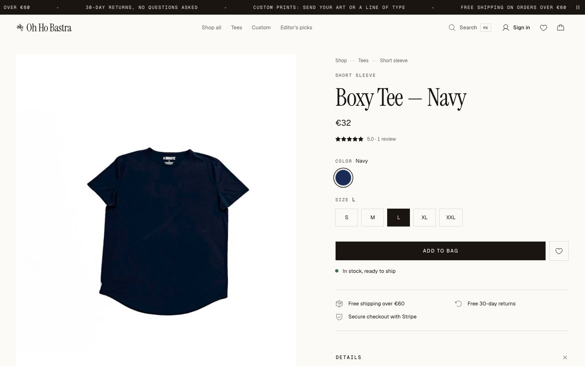
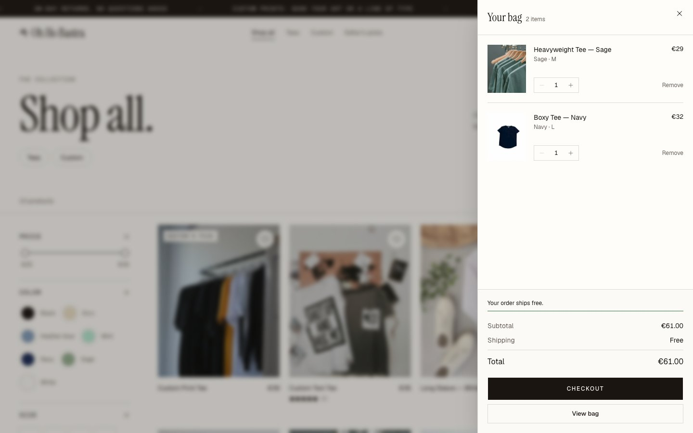
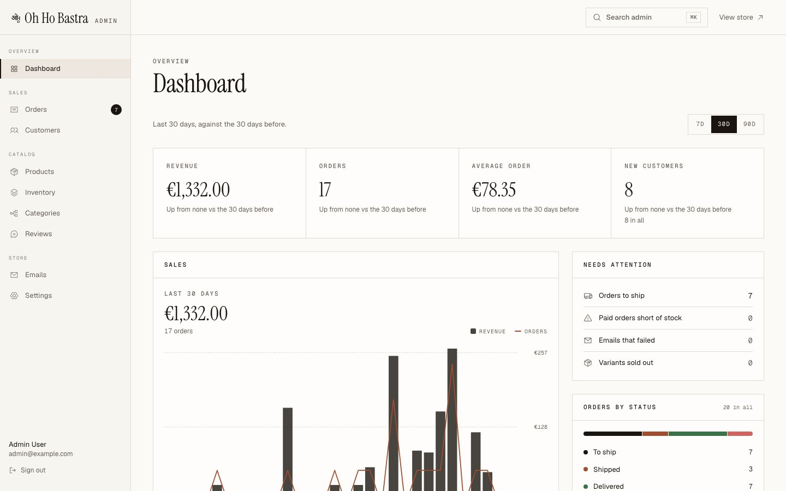
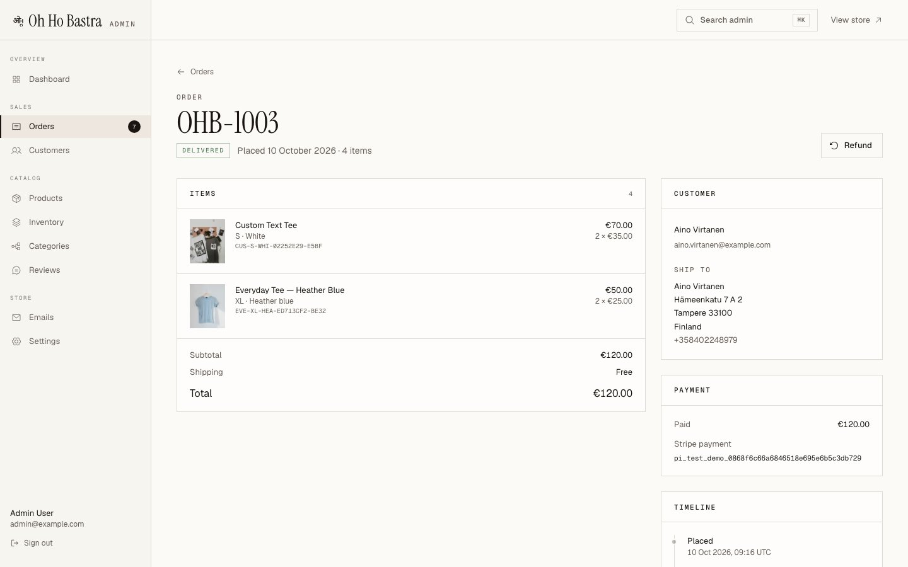
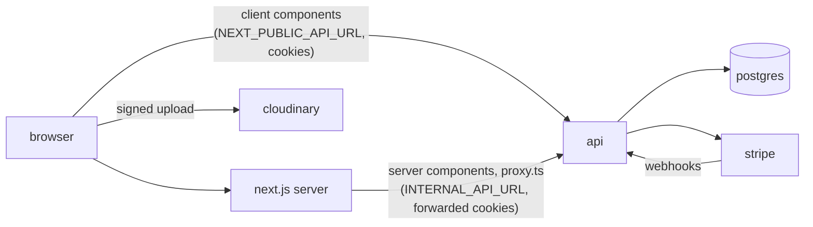
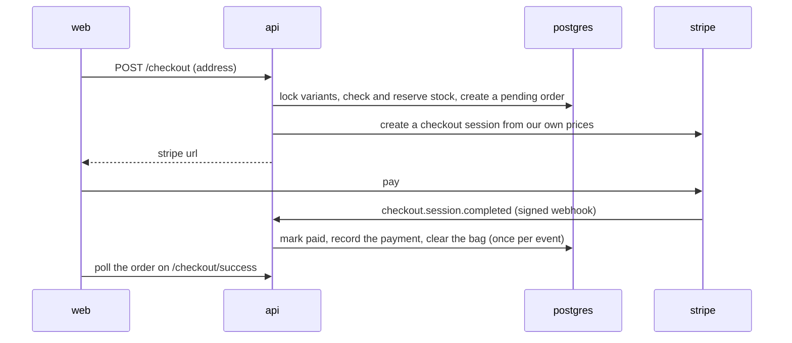

<picture>
  <source media="(prefers-color-scheme: dark)" srcset="docs/brand/mark-light.svg">
  
</picture>

# Oh Ho Bastra

the online shop for oh ho bastra: heavyweight cotton tees in a few colours, plus custom prints and text printed to order. prices are in euros and checkout ships to finland first.

under the hood it's a full-stack store: an express + typescript api and a next.js storefront with an admin panel, stripe checkout, reviews, wishlists and search, held together by one typed api contract. it started from the [cartspace](https://github.com/SuprimKhatri77/cartspace) boilerplate.


| product page                                   | bag                                    |
| ---------------------------------------------- | -------------------------------------- |
|   |  |

| admin dashboard                                    | admin order                                      |
| -------------------------------------------------- | ------------------------------------------------ |
|      |  |

## the shop

- **catalog**: ten tees in two categories, **tees** (short sleeve, long sleeve) and **custom** (custom text, custom print), sized s to xxl, €25–45. `bun run db:seed:catalog` creates them; their photos are in `scripts/catalog-images`.
- **money**: euros (`apps/web/lib/money.ts`, `apps/api/src/checkout/shipping.ts`). shipping is €4.90 flat and free from €60; the web shows the same rule from `apps/web/lib/shipping.ts`, so change both together.
- **orders** are numbered `OHB-1001`, `OHB-1002`…
- **brand**: the ओho mark is `apps/web/components/brand/logo-mark.tsx` (also in `docs/brand`), with the favicon and app icons in `apps/web/app` and `apps/web/public/brand`. store copy and editorial photos live in `apps/web/lib/site.ts` and `apps/web/public/editorial`.

## features

**storefront**

- landing page, `/shop` and category pages with filters (price, size, colour…), sorting and infinite scroll, all kept in the url
- full-text product search (⌘K dialog with live results, and `/shop?q=`)
- product pages with a gallery, colour swatches and size pills (sold-out variants struck through, `?variant=` links), offers with expiry
- a bag drawer and `/cart` with live prices and quantities capped to stock
- stripe hosted checkout with saved addresses, stock reserved while you pay, flat-rate shipping that's free over a threshold (€4.90, free from €60)
- order history with a status timeline, tracking number and refund date
- order emails: confirmed, shipped (with tracking) and refunded, html with a plain-text part
- wishlist, and reviews from verified buyers (a rating summary with a distribution, one review per product)
- three light themes (editorial, studio, botanical), chosen in the admin with live previews, plus a demo-only theme picker for showing the store to clients
- seo: canonical urls, a sitemap and robots.txt, generated share images for products and collections, and json-ld (products with per-variant offers, shipping and returns; breadcrumbs; the store)

**admin** (`/admin`, admin role only)

- dashboard: revenue chart, order counts, average order value, low stock, recent orders
- products: table with search and filters, an editor with direct-to-cloudinary image uploads (drop files in, reorder, remove), variants, stock and offers
- categories: a tree editor (add, rename, move under another parent, delete)
- orders: status tabs and search; ship (with tracking), deliver, cancel and refund through stripe, with optional restock
- reviews: publish or hide, which updates the product's rating
- settings: the store's theme, with a live preview of each

## stack

| layer        | what                                                                                                       |
| ------------ | ---------------------------------------------------------------------------------------------------------- |
| api          | node 22+, express 5, typescript, postgres 17 with node-postgres, sqlc (typed queries), stripe, cloudinary, nodemailer, scalar api docs |
| web          | next.js 16 (app router, `proxy.ts`), react 19, tanstack query 5, tailwind v4, shadcn (base ui), motion    |
| contract     | zod schemas → openapi 3.1 (zod-to-openapi) → typed clients (hey-api), checked both ways in ci              |
| tooling      | turborepo + bun workspaces, docker compose, husky + commitlint + lint-staged, vitest, tsup                 |

## architecture

```text
apps/
  api/                   express 5 + typescript rest api
    migrations/            sql migrations (versions kept in schema_migrations), also the sqlc schema
    queries/               the sql, one file per area (sqlc input)
    src/
      index.ts, app.ts     startup (services, background jobs) and the express app
      routes/              one file per area: the routes and their handlers
      http/                responses, validation (zod → field errors), params, router, middleware
      auth/                sessions, refresh rotation, jwt, passwords
      checkout/            checkout, webhooks, fulfilment (the order state machine)
      catalog/, catalog-admin/, shopping/, admin/   per-area helpers
      emails/              order emails: the outbox sender, smtp, templates
      services/            payments (stripe), cloudinary
      db/                  the pool, the migrator, and gen/ (typed queries generated from queries/*.sql)
      cli/                 migrate and seed commands
      jobs.ts              the loops: session cleanup, checkout expiry, the email outbox
    test/                  vitest integration tests against a real postgres, plus the contract test
    scripts/sqlc-ts.ts     turns sqlc's description of the queries into typed functions
  web/                   next.js storefront + admin
    app/                   routes: (shop), account, auth, admin
    modules/               feature code: catalog, cart, checkout, reviews, wishlist, search, admin…
    lib/                   api clients, proxy (auth guards), image loader, money
    components/ui/         shadcn components
packages/
  types/                 zod schemas, the single source of truth for request/response shapes
  openapi/               endpoint definitions → apps/api/openapi.json
  api-client/            generated browser + server clients
  eslint-config/, typescript-config/
scripts/                 drift checks, catalog seeder (photos in scripts/catalog-images)
```

### requests and auth



- **sessions**: login sets two http-only cookies, a 15-minute access jwt and a refresh token tied to a row in `sessions`. refresh rotates the token with a compare-and-swap; a request that lost a concurrent refresh gets a 30-second grace window instead of a logout. sessions slide for 30 days and end after 90 at most. logout revokes the row, and a background job deletes expired sessions hourly.
- **roles**: `customer` and `admin`, checked by `RequireAuth` / `RequireRole` middleware. the web's `proxy.ts` guards `/account`, `/cart`, `/checkout` and `/admin` and refreshes an expired access token before the page renders; in the browser, an axios interceptor queues requests while one refresh runs.
- **responses**: every response is `{ success, message?, code?, data?, meta?, errors? }`: `meta` carries pagination, `errors` carries per-field validation errors, and `code` is a stable error code (`INSUFFICIENT_STOCK`, `INVALID_ORDER_TRANSITION`…) from one zod enum in `packages/types`, shared by the api and the web.

### the api contract

request and response shapes are written once, as zod schemas in `packages/types`. from there:

1. `packages/openapi` registers each endpoint (`src/paths/*.ts`) and writes `apps/api/openapi.json`, which the api serves at `/docs` (scalar) and `/openapi.json`.
2. `packages/api-client` generates a typed sdk from that spec: one for the browser, one for server components.
3. the web imports the zod types and the sdk, so a renamed field is a type error.

two checks keep the sides honest:

- `bun run generate:check` fails when the committed spec or clients are out of date.
- `apps/api/test/contract.test.ts` compares the spec with the express routes: every route is documented and every documented route exists. error and validation codes need no check: the api imports them from the same zod enums the spec is built from.

to add an endpoint: write its schemas in `packages/types` (and any new error code in `packages/types/src/api/error-codes.ts`), the path in `packages/openapi/src/paths`, run `bun run generate`, then add the route and its handler in `apps/api/src/routes`, validating the body with `parseBody(Schema, req, res)`.

sql works the same way: queries live in `apps/api/queries/*.sql`, and `bun run db:sqlc` turns them into typed functions in `apps/api/src/db/gen` (sqlc checks each query against the migrations, then `scripts/sqlc-ts.ts` writes the typescript). rows keep their snake_case column names, so a row can be sent as json as it is. `bun run db:sqlc:check` fails on drift.

### checkout and orders



- stock is reserved when checkout starts, so a paid order can never oversell. an unpaid page expires after about 30 minutes; stripe's `checkout.session.expired` cancels the order and returns the stock, and a sweep in the api (every 5 minutes and before each checkout) catches any expiry whose webhook never arrived.
- webhooks are signature-checked, recorded in `stripe_events` so a retry is a no-op, and applied in a transaction. an order paid after its reservation was released takes back what stock it can and records the shortfall.
- orders move through one tested transition table (`apps/api/src/checkout/fulfilment.ts`): `pending → paid → shipped → delivered`, `pending → cancelled`, and `paid | shipped | delivered → refunded`. every transition locks the order row. a refund is a full stripe refund with an idempotency key per order, so retrying can't refund twice. restocks return only what the order actually took.
- each paid, shipped or refunded order queues its email in the same transaction (see [emails](#emails)).
- prices are in cents everywhere. an offer applies while `offer_price` is set and `offer_expires_at` is empty or in the future, and one sql expression decides it for listings, sorting, the cart and checkout. shipping is a flat rate, free from a threshold (`internal/constants/shipping.go`).

### caching

- public catalog pages render on the server through the next data cache (tag `catalog`: categories for 5 minutes, listings and products for 1 minute). admin writes call a server action that checks the role and busts the tag, so changes show at once.
- listings prefetch their first page on the server and hand it to tanstack query (`HydrationBoundary`); filters update the url with `history.pushState` and fetch on the client.
- every list is paginated: infinite scroll in the storefront, page numbers in the admin. there's no redis yet.

## getting started

**prerequisites**: [bun](https://bun.sh) 1.3, [node](https://nodejs.org) 22 or newer, docker. to change the sql, also [sqlc](https://sqlc.dev) 1.30 or newer (`brew install sqlc`). for payments, the [stripe cli](https://docs.stripe.com/stripe-cli).

```sh
bun install
cp .env.example .env.local
```

every app reads the single root `.env.local`. fill in at least:

- `POSTGRES_USER`, `POSTGRES_PASSWORD` and a matching `DATABASE_URL`
- `JWT_ACCESS_SECRET` and `JWT_REFRESH_SECRET` (`openssl rand -hex 32`)
- `CLOUDINARY_*` for image uploads in the admin
- `SEED_ADMIN_PASSWORD` and `SEED_CUSTOMER_PASSWORD`

wrap any value containing `$` in single quotes, or docker compose will try to expand it.

### run with docker (recommended)

```sh
bun run docker:dev:up                         # api :5000 (hot reload), web :3000, postgres :5432, mailpit :8025
docker exec ohhobastra-api bun run seed       # the seed admin + customer
bun run db:seed:catalog                       # the 10 tees, photos uploaded to your cloudinary
```

migrations run when the api container starts. open http://localhost:3000, sign in as the seed admin and visit `/admin`. api docs are at http://localhost:5000/docs.

to start over with an empty database (for example after migrations were rewritten): `bun run docker:dev:reset`, then seed again.

### run without docker

point `DATABASE_URL` at `localhost` instead of `db` and `INTERNAL_API_URL` at `http://localhost:5000`, then:

```sh
bun run db:migrate
bun run db:seed
bun run dev          # api + web through turbo
```

### stripe (test mode)

1. put your test secret key (`sk_test_…`) in `STRIPE_SECRET_KEY`. without it the api still runs and `POST /checkout` answers 503.
2. forward webhooks to the local api and copy the signing secret it prints into `STRIPE_WEBHOOK_SECRET_LOCAL`:

   ```sh
   stripe listen --forward-to localhost:5000/api/v1/webhooks/stripe
   ```

3. restart the api, check out, and pay with `4242 4242 4242 4242`, any future date and any cvc.

the success and cancel pages are built from `FRONTEND_URL`. in production, create a dashboard webhook endpoint for `checkout.session.completed`, `checkout.session.expired`, `checkout.session.async_payment_succeeded` and `checkout.session.async_payment_failed`, and put its secret in `STRIPE_WEBHOOK_SECRET`.

### cloudinary

the admin uploads images straight from the browser with a signature from `POST /admin/uploads/signature`, into the `ohhobastra/products` folder on your cloud. the api only accepts image urls from that folder, and deleting a product deletes its images unless a past order still shows them. `db:seed:catalog` uploads its photos the same way, so it needs cloudinary set up.

### emails

the api emails the shopper when an order is **confirmed** (paid), **shipped** (with the tracking number) and **refunded**. there's no email for delivered, or for cancelling an unpaid checkout.

- each status change writes its email to an `email_outbox` table in the same transaction, so a change that commits always gets its email and one that rolls back never does. there's one email of each kind per order, so a replayed stripe webhook doesn't send twice.
- a sender inside the api delivers the outbox every 10 seconds, rendering each email from the order as it is then. a failed send is retried after 1, 2, 4… minutes (at most an hour apart, 8 tries); a server that refuses the address for good fails it at once. an email still unsent after 48 hours is dropped rather than sent late. outcomes are in the table (`status`, `attempts`, `last_error`) and the logs.
- emails go out over plain smtp ([nodemailer](https://nodemailer.com)), so any provider works: set `SMTP_HOST`, `SMTP_PORT`, `SMTP_TLS` (`starttls`, `tls` or `none`), `SMTP_USERNAME`, `SMTP_PASSWORD` and `MAIL_FROM` (an address on a domain the provider has verified). resend, postmark and amazon ses all offer smtp.
- in development the compose stack runs [mailpit](https://mailpit.axllent.org), which catches every email: read them at http://localhost:8025. `.env.example` is already set up for it.
- without `SMTP_HOST`, emails stay queued and the api logs a warning at startup. a bad mail setting (for example no `MAIL_FROM`) stops the api from starting.

the templates are in `apps/api/src/emails/templates.ts` (one layout for all three, html and plain text).

### themes

the store ships three light themes: **editorial** (warm paper, a light serif, softly rounded corners; the default), **studio** (crisp white, bold sans-serif, soft corners) and **botanical** (cream and forest green, a soft serif, rounded shapes).

- the store owner picks the theme in **admin → settings**. each option shows a live preview in its own theme, and choosing one previews it across the admin before saving. saving applies it to every page at once: the setting is cached in next's data cache, and the cache is expired on save.
- `STORE_THEME` is the fallback while the api can't be reached (default: editorial).
- `DEMO_THEME_PICKER=true` adds a floating picker in the bottom-right corner for demos. A visitor's pick is kept in a cookie and applied on the server, so pages never flash the wrong theme. Leave it off for a real store.

a theme is a `[data-theme="…"]` block of tokens in `apps/web/app/globals.css`: colours, the headline font and its style, and four corner radii (`rounded-control`, `rounded-field`, `rounded-panel`, `rounded-media`). to add a theme:

1. add that block to `globals.css`
2. add an entry to `THEMES` in `apps/web/lib/themes.ts`, and its id to `StoreThemeSchema` in `packages/types/src/settings` (then `bun run generate`); the api validates against that schema
3. load a new font in `app/layout.tsx` with `preload: false`, if the theme needs one

## scripts

| script                                     | what it does                                                                      |
| ------------------------------------------ | --------------------------------------------------------------------------------- |
| `bun run dev`                              | api + web                                                                         |
| `bun run build`                            | build everything                                                                  |
| `bun run docker:dev:up` / `docker:dev:down` | start / stop the docker stack                                                     |
| `bun run docker:dev:reset`                 | delete the database volume and start the stack again                              |
| `bun run db:migrate` / `db:migrate:down`   | apply / roll back migrations (`N=1` for down; `N` is required)                    |
| `bun run db:sqlc`                          | regenerate the typed queries in `apps/api/src/db/gen`                             |
| `bun run db:seed`                          | create the seed admin and customer (`SEED_*` in `.env.local`)                     |
| `bun run db:seed:catalog`                  | add the tees and their categories through the running api as the seed admin      |
| `bun run generate`                         | regenerate `openapi.json` and the api clients                                     |
| `bun run generate:check` / `db:sqlc:check` | fail if generated code is out of date                                             |
| `bun run check-types`                      | typecheck every package                                                           |
| `bun run lint`                             | eslint                                                                            |
| `bun run test:api` / `test:web`            | api tests (vitest, against postgres) / web tests (bun test)                       |
| `bun run format`                           | prettier                                                                          |
| `bun run ci`                               | everything ci runs: drift checks, types, lint, tests, build                      |

## testing and ci

- **api**: vitest integration tests against a real postgres (a throwaway `ohhobastra_test` database, recreated from the migrations each run; your dev data is never touched): every endpoint, the order transition table, session rotation, validation, emails, stripe payloads, and the contract test (`bun run test:api`). postgres must be running (`docker compose ... up -d db`).
- **web**: bun tests for the proxy guards, the refresh interceptor, filter and url parsing, the image loader, cart and order helpers (`bun run test:web`).
- **ci**: there's no hosted ci yet. `bun run ci` runs every check locally (drift checks, types, lint, tests, build), and the pre-push hook runs most of them.

## deploy

the api migrates with its own command (`src/cli/migrate.ts`, built to `dist/migrate.js`). it runs everywhere the same way: the dev container's start, `bun run db:migrate`, and the deploy's start command. `migrate up` applies what's pending; `down N`, `version` and `force V` (after fixing a migration that failed halfway) cover the rest. new migration files are plain sql (`NNNNNN_name.up.sql` / `.down.sql`). versions are kept in `schema_migrations` the way golang-migrate kept them, so databases set up by the old go api carry on where they were.

**api on render** (node web service):

| setting        | value                                                                                     |
| -------------- | ----------------------------------------------------------------------------------------- |
| root directory | the repo root (the api build needs the workspace's `packages/types`)                      |
| build command  | `bun install && cd apps/api && bun run build`                                             |
| start command  | `cd apps/api && node dist/migrate.js up && node dist/index.js` (`openapi.json` and `migrations/` are read from there) |
| health check   | `/api/v1/health`                                                                          |

migrating in the start command works without a pre-deploy step (render's free plan has none). if a migration fails, the server never starts and the previous deploy keeps serving. several instances starting at once are fine: postgres advisory locks let one migrate while the others wait.

env: `NODE_ENV=production`, `DATABASE_URL`, `JWT_ACCESS_SECRET`, `JWT_REFRESH_SECRET`, the `CLOUDINARY_*` keys, `FRONTEND_URL` (the storefront's https url), `COOKIE_DOMAIN`, `TRUSTED_PROXIES`, `STRIPE_SECRET_KEY` and `STRIPE_WEBHOOK_SECRET`, and for emails `SMTP_HOST`, `SMTP_PORT`, `SMTP_TLS`, `SMTP_USERNAME`, `SMTP_PASSWORD` and `MAIL_FROM` (see [emails](#emails)). `COOKIE_DOMAIN` and the `Secure` flag only apply in production.

if order emails time out on render, its free instances may be blocking the standard smtp ports: resend also accepts `SMTP_PORT=2587` with `SMTP_TLS=starttls`.

**web on vercel**: root directory `apps/web`, with `NEXT_PUBLIC_API_URL` and `INTERNAL_API_URL` (both the api's public url) and `FRONTEND_URL` (canonical urls, the sitemap and share images).

**cookies**: put the api on a subdomain of the storefront, e.g. `shop.example.com` and `api.shop.example.com`, and set `COOKIE_DOMAIN=shop.example.com`. the auth cookies then reach both hosts, which `proxy.ts` needs to guard `/account` and `/admin`.

**stripe**: add a live webhook endpoint at `https://<api host>/api/v1/webhooks/stripe` for `checkout.session.completed`, `checkout.session.async_payment_succeeded`, `checkout.session.async_payment_failed` and `checkout.session.expired`, and put its signing secret in `STRIPE_WEBHOOK_SECRET`.

## contributing

- branch off `main` (`feat/…`, `fix/…`, `docs/…`, `chore/…`) and open a pull request
- commits follow [conventional commits](https://www.conventionalcommits.org), enforced by commitlint
- pre-commit formats staged files and regenerates sqlc code when queries or migrations change; pre-push runs the typecheck, the tests and the build

## not built yet

- guest carts (the bag needs an account)
- partial refunds and returns
- emails beyond orders and password reset (for example verifying the address)
- finnish payment methods (paytrail, mobilepay): checkout is stripe only
- redis or a job queue (expired checkouts, old sessions and the email outbox are handled by loops inside the api process)

## credits

- built on [cartspace](https://github.com/SuprimKhatri77/cartspace) by suprim khatri
- product and editorial photos from [unsplash](https://unsplash.com), under the unsplash license; photographers are listed in `scripts/catalog-images/CREDITS.md` and `apps/web/public/editorial/CREDITS.md`
- the screenshots show demo data: the seeded catalog, with made-up customers and orders
